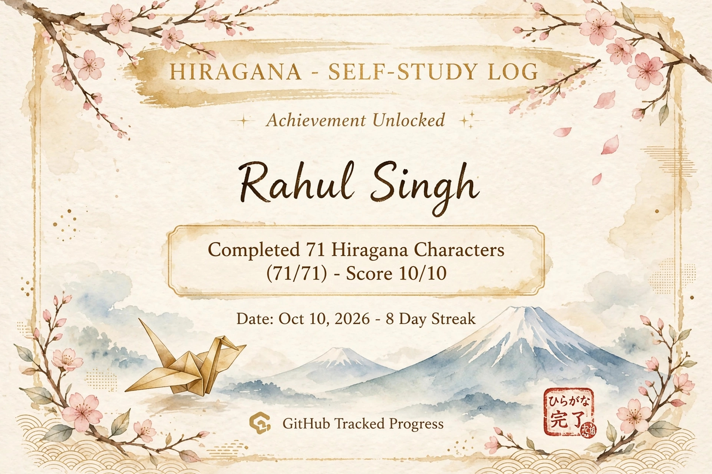

oct 8- Hi there 👋

 PRE-JAVA MODE
Java Starts: November 2026

Right now I am learning Hiragana and maintaining GitHub streak.
Hiragana Day 1-7 done.

October 9-## 🇯🇵 Hiragana Progress - Day 8/9 Completed

### Streak: 🔥 8 Days

| Day | Characters | Status |
| :--- | :--- | :--- |
| Day 1 | あいうえお | ✅ Done |
| Day 2 | かきくけこ | ✅ Done |
| Day 3 | さしすせそ | ✅ Done |
| Day 4 | たちつてと | ✅ Done |
| Day 5 | なにぬねの | ✅ Done |
| Day 6 | はひふへほ | ✅ Done |
| Day 7 | まみむめも | ✅ Done |
| Day 8 | やゆよ らりるれろ | ✅ Done |
| Day 9 | わをん | ⏳ Tomorrow |

**Score:** Hard Test - 19/20 🔥
**Next:** Final Day - わをん

Progress: 43/46 (93%)

october 10- - [x] Day 9 わをん ✅ - HIRAGANA COMPLETE 46/46 🎉

October 10-
 Hiragana Dakuten (Voiced) + Handakuten (Semi-voiced) Mapping
const hiraganaDakuten = {
  // K -> G
  "か": "が", "き": "ぎ", "く": "ぐ", "け": "げ", "こ": "ご",
  // S -> Z
  "さ": "ざ", "し": "じ", "す": "ず", "せ": "ぜ", "そ": "ぞ",
  // T -> D
  "た": "だ", "ち": "ぢ", "つ": "づ", "て": "で", "と": "ど",
  // H -> B (Dakuten) / P (Handakuten)
  "は"

October 11-# 🇯🇵 Japanese Learning Progress

> Daily tracker for Hiragana & Katakana

### 📅 Date: 11 Oct 2026

#### ✅ Hiragana Mastered
- Vowels: あ い う え お (a i u e o)
- K-line: か き く け こ (ka ki ku ke ko)
- S-line: さ し す せ そ (sa shi su se so) - learning
- T-line: た ち つ て と
- N, H, M, Y, R, W, n
- Total: 46 chars - A to KO is perfect (20/20)

#### ✅ Katakana Mastered
- ア イ ウ エ オ (A I U E O)
- カ キ ク ケ コ (KA KI KU KE KO)
- Can read loanwords: インド (INDO = India), コーヒー (Coffee)

#### 🎯 Test Scores
- Round 1 (A-KO): 20/20 💯
- Round 2 (Mix): 20/20 💯
- Final Test (25 Mix): 24/25

#### 📚 Next Target
- SA SHI SU SE SO (さ し す せ そ / サ シ ス セ ソ)

---
**Trick:** Hiragana = small (ka), Katakana = CAPITAL (KA) for practice

Date- October 12 2026

SA SHI SU SE SO (さ し す せ そ / サ シ ス セ ソ)
completed

#### 📚 Next Target (Katakana)
- TA CHI TSU TE TO (タチツテト)

Date- October 13 2026

# Japanese - Katakana Progress

## ✅ Completed: 30 Katakana

### A-Line
- ア = A, イ = I, ウ = U, エ = E, オ = O

### KA-Line
- カ = KA, キ = KI, ク = KU, ケ = KE, コ = KO

### SA-Line
- サ = SA, シ = SHI, ス = SU, セ = SE, ソ = SO

### TA-Line
- タ = TA, チ = CHI, ツ = TSU, テ = TE, ト = TO

### NA-Line (NEW - Updated Today)
- ナ = NA, ニ = NI, ヌ = NU, ネ = NE, ノ = NO

### HA-Line (NEW - Updated Today)
- ハ = HA, ヒ = HI, フ = FU, ヘ = HE, ホ = HO

**Status:** 30/46 Katakana Done - 100% Accuracy in test (50/50)
Next: MA-Line (マミムメモ)

october 14 -"Katakana: Ma + Ya line locked - 38/46 done"

October 15-# Katakana - Day Complete

## Ra Line
ラ - ra
リ - ri
ル - ru
レ - re
ロ - ro

## Wa Line + N
ワ - wa
ヲ - wo
ン - n

## Practice Words
ラーメン - raamen
ロボット - robotto
ワイン - wain

ペン - pen
パン - pan

## Note
ソ (so) = 2 strokes
ン (n) = 1 stroke
Confusion clear - Test 46/46

## Dakuten - DONE
ガ ギ グ ゲ ゴ - G Line
ザ ジ ズ ゼ ゾ - Z Line
ダ ヂ ヅ デ ド - D Line
バ ビ ブ ベ ボ - B Line
パ ピ プ ペ ポ - P Line
Test: 10/10 Passed

October 16-# Japanese Reading - 4 Rules

## Rule 1: Dakuten ゛ (Ten-Ten) & Handakuten ゜ (Maru)

- K -> G : か ka → が ga
- S -> Z : さ sa → ざ za
- T -> D : た ta → だ da
- H -> B : は ha → ば ba

Handakuten lagne se H -> P ho jata hai:
- は ha → ぱ pa
- ひ hi → ぴ pi

Example: がっこう (gakkou), びょういん (byouin), でんしゃ (densha)

## Rule 2: Chhota Tsu っ (Sokuon)

- がっこう = ga + kkou = gakkou
- ちょっと = cho + tto = chotto
- しゅくだい = shukudai 

## Rule 3: small Ya Yu Yo ゃ ゅ ょ (Yoon)
Chhota ゃゅょ 

- き + ゅ = kyu : きゅうり = kyuuri
- り + ょ = ryo : りょうり = ryouri
- し + ゅ = shu (shyu nahi) : しゅくだい = shukudai
- ち + ゅ = chu (chyu nahi) : ちゅうがくせい = chuugakusei
- じ + ゅ = ju (jyu nahi) : ジュース = juusu

Special: shi, chi, ji ,'y' 

## Rule 4: Long Vowel ー aur ou / ii
- Katakana me ー 
    - ビール = bi + i + ru = biiru
    - ジュース = ju + u + su = juusu

- Hiragana me ou = oo, ei = ee
    - がっこう = gakkou (kou = koo)
    - きょうと = kyouto (kyo + u = kyoo + to)
    - せんせい = sensei (sei = see)
    - とうきょう = toukyou

October 17-[
  { "japanese": "パン", "romaji": "pan", "english": "Bread", "type": "noun" },
  { "japanese": "コーヒー", "romaji": "koohii", "english": "Coffee", "type": "noun" },
  { "japanese": "たまご", "romaji": "tamago", "english": "Egg", "type": "noun" },
  { "japanese": "みず", "romaji": "mizu", "english": "Water", "type": "noun" },
  { "japanese": "いきます", "romaji": "ikimasu", "english": "To go", "type": "verb" },
  { "japanese": "きます", "romaji": "kimasu", "english": "To come", "type": "verb" },
  { "japanese": "たべます", "romaji": "tabemasu", "english": "To eat", "type": "verb" },
  { "japanese": "のみます", "romaji": "nomimasu", "english": "To drink", "type": "verb" },
  { "japanese": "つくります", "romaji": "tsukurimasu", "english": "To make", "type": "verb" },
  { "japanese": "かいます", "romaji": "kaimasu", "english": "To buy", "type": "verb" },
  { "japanese": "あいます", "romaji": "aimasu", "english": "To meet", "type": "verb" },
  { "japanese": "はたらきます", "romaji": "hatarakimasu", "english": "To work", "type": "verb" },
  { "japanese": "ききます", "romaji": "kikimasu", "english": "To listen", "type": "verb" },
  { "japanese": "べんきょうします", "romaji": "benkyou shimasu", "english": "To study", "type": "verb" }
]

October 18-# Japanese Vocab - Day 2

15. ききます - kikimasu - Sunna
16. テレビ - terebi - TV
17. ともだち - tomodachi - Dost
18. ねます - nemasu - Sona
19. かきます - kakimasu - Likhna
20. あるきます - arukimasu - Chalna
21. そうじ します - souji shimasu - Safai karna
22. りょうり します - ryouri shimasu - Khana banana
23. およぎます - oyogimasu - Tairna
24. はなします - hanashimasu - Bolna
25. かいもの します - kaimono shimasu - Shopping karna
26. スーパー - suupaa - Supermarket
27. コンビニ - konbini - Convenience Store
28. せんせい - sensei - Teacher
29. おきます - okimasu - Uthna
30. よみます - yomimasu - Padhna

October 19-

## Vocab - 10 Words
| Japanese (Romaji) | Meaning |
| :--- | :--- |
| inu | dog |
| neko | cat |
| hon | book |
| kuruma | car |
| densha | train |
| mise | shop |
| tomodachi | friend |
| kazoku | family |
| sensei | teacher |
| gakusei | student |

## Kanji - 2
| Kanji | Meaning |
| :--- | :--- |
| 人 | person |
| 山 | mountain |

## Grammar - 1 Rule
**Watashi wa ___ desu.**
- Watashi wa gakusei desu. = Main student hoon.
- Watashi wa sensei ja arimasen. = Main teacher nahi hoon.

## Test Score
14 / 14 ✅

October 20-
# 10 Vocab + 2 Kanji

## Vocab
| No | Japanese | Reading | Meaning | Example |
|---|---|---|---|---|
| 1 | 予算 | yosan | Budget | 予算を超えた |
| 2 | 合計 | goukei | Total / Sum | 合計はいくらですか |
| 3 | 部品 | buhin | Parts / Components | PCの部品 |
| 4 | 作成 | sakusei | To create / Make | 資料を作成する |
| 5 | 完成 | kansei | Complete / Finished | 完成した |
| 6 | 勉強 | benkyou | Study | 日本語を勉強する |
| 7 | 復習 | fukushuu | Revision | 復習をします |
| 8 | 理解 | rikai | Understanding | 理解したいです |
| 9 | 質問 | shitsumon | Question | 質問があります |
| 10 | 説明 | setsumei | Explanation | 説明してください |

## Kanji
1.  **作 (SAKU / tsukuru)** - Make - Word: 作成 (sakusei)
2.  **完 (KAN)** - Complete - Word: 完成 (kansei)

## Sentence for today
予算を理解したいです。(Yosan wo rikai shitai des

21 Oct 2026

## Theme: PC / Daily Life

### Vocab (10)
1. パソコン (pasokon) - Computer / PC
2. たかい / 高い (takai) - Expensive
3. やすい / 安い (yasui) - Cheap
4. かう / 買う (kau) - To buy
5. つくる / 作る (tsukuru) - To make / build
6. おかね / お金 (okane) - Money
7. いくら (ikura) - How much
8. これ (kore) - This
9. それ (sore) - That
10. とても (totemo) - Very

Sentence: このパソコンはとてもたかいです。

### Kanji (2)
1. 買 - バイ, か・う - kau - to buy
2. 高 - コウ, たか・い - takai - expensive/high

Total: 60 vocab done + 6 kanji 

october 22-

## 10 Vocab
1. 今日 - きょう (kyou) - Today
2. 明日 - あした (ashita) - Tomorrow
3. 昨日 - きのう (kinou) - Yesterday
4. 朝 - あさ (asa) - Morning
5. 昼 - ひる (hiru) - Afternoon
6. 夜 - よる (yoru) - Night
7. 家 - いえ (ie) - House
8. 学校 - がっこう (gakkou) - School
9. 先生 - せんせい (sensei) - Teacher
10. 本 - ほん (hon) - Book

## Kanji of the Day
**学 - ガク (gaku)

october 23-## 10 Vocab

1. けんきゅう (kenkyuu) - Research
2. じっけん (jikken) - Experiment
3. けっか (kekka) - Result
4. ほうほう (houhou) - Method
5. せんたく (sentaku) - Selection
6. ひかく (hikaku) - Comparison
7. かいぜん (kaizen) - Improvement
8. がめん (gamen) - Screen
9. ほぞん (hozon) - Save
10. れんらく (renraku) - Contact

| No | Hiragana | Romanji | English | Status |
|---|---|---|---|---|
| 1 | けんきゅう | kenkyuu | Research | ✅ |
| 2 | じっけん | jikken | Experiment | ✅ |
| 3 | けっか | kekka | Result | ✅ |
| 4 | ほうほう | houhou | Method | ✅ |
| 5 | せんたく | sentaku | Selection | ✅ |
| 6 | ひかく | hikaku | Comparison | ✅ |
| 7 | かいぜん | kaizen | Improvement | ✅ |
| 8 | がめん | gamen | Screen | ✅ |
| 9 |

October 24-# Japanese Vocab 81-90 - MEXT High Frequency

| No | Japanese (Hiragana) | Romaji | English | Hindi |
|----|---------------------|--------|---------|-------|
| 81 | けいけん | keiken | experience | anubhav |
| 82 | かいはつ | kaihatsu | development | vikas |
| 83 | きぼう | kibou | hope | umeed |
| 84 | もくひょう | mokuhyou | goal | lakshya |
| 85 | どりょく | doryoku | effort | mehnat |
| 86 | せいこう | seikou | success | safalta |
| 87 | しっぱい | shippai | failure | asafalta |
| 88 | れんしゅう | renshuu | practice | abhyaas |
| 89 | じゅんび | junbi | preparation | taiyaari |
| 90 | かんしゃ | kansha | gratitude | abhaar |

# Total Vocab Completed: 90

October 25-# N5 Vocabulary - 70 Words Done

## Day 1-2 (60 words)
1. ikimasu - to go
2. kimasu - to come
3. pan - bread
4. bread
5. benkyou suru - to study
6. tabemasu - to eat
... (tere 60 wale)
60. byouin - hospital

## Day 3 (10 words) - NEW
61. imouto - younger sister
62. otouto - younger brother
63. hito - person
64. tsuma - wife
65. haha - my mother
66. chichi - my father
67. otto - husband
68. ichinensei - first year student
69. ani - older brother
70. ane - older sister

Total: 70/800 N5 words done

October 26- # Japanese Vocab 
1. hitori (一人) - one person
2. futari (二人) - two people
3. otoko (男) - man
4. onna (女) - woman
5. otokonoko (男の子) - boy
6. onnanoko (女の子) - girl
7. kaishain (会社員) - company employee
8. shain (社員) - employee
9. asatte (明後日) - day after tomorrow
10. ginkouin (銀行員) - bank employee

October 27-

| No | Romaji | Japanese | Meaning |
|----|--------|----------|---------|
| 1 | ototoi | 一昨日 | day before yesterday |
| 2 | kyonen | 去年 | last year |
| 3 | ima | 今 | now |
| 4 | rainen | 来年 | next year |
| 5 | kotoshi | 今年 | this year |
| 6 | mainichi | 毎日 | every day |
| 7 | shuu | 週 | week |
| 8 | raishuu | 来週 | next week |
| 9 | maiban | 毎晩 | every evening |
| 10 | maiasa | 毎朝 | every morning |

October 28-

| No | Japanese | Romaji | English | Kanji |
|---|---|---|---|---|
| 1 | げつようび | getsuyoubi | Monday | 月曜日 |
| 2 | かようび | kayoubi | Tuesday | 火曜日 |
| 3 | すいようび | suiyoubi | Wednesday | 水曜日 |
| 4 | もくようび | mokuyoubi | Thursday | 木曜日 |
| 5 | きんようび | kinyoubi | Friday | 金曜日 |
| 6 | どようび | doyoubi | Saturday | 土曜日 |
| 7 | にちようび | nichiyoubi | Sunday | 日曜日 |
| 8 | はん | han | half | 半 |
| 9 | じ | ji | o'clock | 時 |
| 10 | じかん | jikan |

October 29-

| No | Romaji | Hiragana / Katakana | English | Japanese Example |
|---|---|---|---|---|
| 1 | doa | ドア | door | Kyoushitsu no doa |
| 2 | isu | いす | chair | isu ni suwaru |
| 3 | toshokan | としょかん | library | Nagasaki Daigaku toshokan |
| 4 | yuubinkyoku | ゆうびんきょく | post office | yuubinkyoku wa doko? |
| 5 | machi | まち | town | Kumamoto machi |
| 6 | kuni | くに | country | watashi no kuni wa Indo desu |
| 7 | hoteru | ホテル | hotel | hoteru ni tomaru |
| 8 | resutoran | レストラン | restaurant | resutoran de taberu |
| 9 | kouen | こうえん | park | kouen de sanpo suru |
| 10 | heya | へや | room | watashi no heya |
| 11 | gakkou | がっこう | school | Nihon no gakkou |
| 12 | depaato | デパート | dept.

October 30-

| No. | Vocab | Kana | Kanji/Katakana | Meaning |
|-----|-------|------|----------------|---------|
| 1 | watashi | わたし | 私 | I |
| 2 | anata | あなた | 貴方 | you (formal) |
| 3 | ichi | いち | 一 | one |
| 4 | ni | に | 二 | two |
| 5 | san | さん | 三 | three |
| 6 | yon | よん | 四 | four |
| 7 | go | ご | 五 | five |
| 8 | roku | ろく | 六 | six |
| 9 | nana | なな | 七 | seven |
| 10 | hachi | はち | 八 | eight |
| 11 | kyuu | きゅう | 九 | nine |
| 12 | juu | じゅう | 十 | ten |
| 13 | hyaku | ひゃく | 百 | hundred |
| 14 | biiru | びーる | ビール | beer |
| 15 | sake | さけ | 酒 | sake/alcohol |

